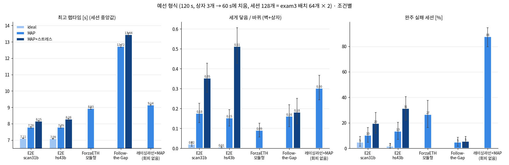
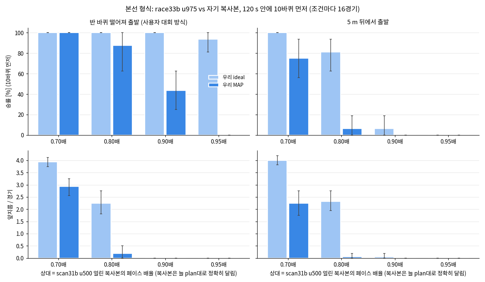

# C. 대회 형식으로 다시 잰 결과 (2026-11-28, 독립 검증)

이전 개발자의 평가표는 쓰지 않았다. 같은 체크포인트를 직접 다시 굴려서, 대회 점수와 바로 대응하는 지표로 쟀다. 학습은 하지 않았고, 기존 파일은 고치지 않았고, 커밋도 하지 않았다. GPU는 RTX 4070 SUPER 한 장만 썼다(`CUDA_VISIBLE_DEVICES=0`, `torch.cuda.get_device_name` 출력으로 확인). 시험은 한 번에 하나씩 차례로 돌렸고, 실제로 걸린 시간은 약 2시간이다. 세션 수는 줄이지 않았다. 조건마다 128 세션(또는 128 경기)을 다 돌렸다.

## 0. 결론

1. **이전 표의 숫자는 그 조건 그대로 돌리면 다시 나온다.** 그런데 그 조건은 "plan을 완벽하게 따라간다(ideal)"는 가정이다. 실차처럼 MAP 추종기와 차 물리로 굴리면 숫자가 크게 나빠진다.
   - 가장 빠른 바퀴: 7.1 s → 7.8 s
   - 120 s 동안 세게 닿음: 세션당 0.1-0.3회 → 1.9-2.3회
   - 120 s 동안 한 번도 세게 닿지 않은 세션: 81-91 % → 39-41 %
   - 완주 실패: 2-5 % → 10-13 %
2. **이전에 "최고"로 고른 순서가 뒤집힌다.** ideal에서는 hs43b u900이 scan31b u475보다 120 s에 8.5 m 더 간다. MAP에서는 62 m [20-112] 덜 간다. 마찰과 지연을 더 나쁘게 잡은 조건에서는 138 m 덜 가고, 완주 실패도 31 % 대 20 %로 더 많다. 선정 시험(ideal)이 "완벽하게 따라갈 때만 통하는 정책"을 골라내고 있다.
3. **1대1(MAP):** 자기 복사본을 상대로 128경기 중 39 %만 이겼다.
   - 5 m 뒤에서 출발하면, 상대가 0.8배로 느려도 6 %만 이긴다. 앞지르기는 경기당 0.06번이고, 120 s 중 78 s를 그 차 바로 뒤에서 보낸다.
   - 0.95배 상대에게는 출발 방식과 상관없이 전패했다.
   - ideal 조건에서도 10 % 느린 차는 앞지르지 못한다(경기당 0.03번).
4. **기준선과 비교하면 (같은 세션, MAP 물리): 빠르지만 깨끗하지 않다.**
   - 속도는 E2E가 확실히 앞선다. 가장 빠른 바퀴가 E2E 7.8 s, ForzaETH 모듈형 8.9 s, Follow-the-Gap 12.7 s다. 연속 바퀴 수도 E2E가 가장 길다(11.1 / 9.3 / 6.6).
   - 접촉은 E2E가 더 많다. 세게 닿음이 ForzaETH 모듈형보다 상자는 약 3배(세션당 1.30 대 0.45), 벽은 약 2배(1.02 대 0.47)다. 벽은 FTG의 20배(0.05)다.
   - 강건성은 FTG가 낫다. 스트레스 조건에서 FTG는 거의 그대로인데(완주 실패 5 → 5 %), E2E는 10 → 20 %(hs43b는 13 → 31 %)로 무너진다.

**오늘 대회에 나간다면:**
- 예선: 랩타임만 보면 상위권일 수 있다. 하지만 세션 10번 중 6번은 세게 한 번 이상 닿고, 1번은 끼이거나 역주행해서 완주하지 못한다.
- 본선: 우리보다 조금 느린 차만 만나도 뒤에 갇힌다. 우리와 비슷한 속도의 차에게는 진다.

## 1. 무엇을 어떤 경로로 굴렸나 (코드에서 확인한 가정)

| 항목 | 확인한 내용 |
|---|---|
| 평가 대상 | 예선: `pick_scan31b_u475`(11-24에 "최고"로 꼽힌 것), `pick_hs43b_u900`(콘솔 목록 11-28 "★ 예선 가장 빠름"). 본선: `pick_race33b_u975`(콘솔 "★ 1대1 앞지르기"), `pick_rc42a_u950`(콘솔 "1대1 덜 박음"). 파일은 모두 `~/f1sim_runs/pick_*/state_latest.pt`. cp36c와 stack38a는 이 PC에서 선정본으로 지정된 것이 없어 빼고, 콘솔 목록이 현재 "★"로 표시한 것을 골랐다 |
| 학습할 때의 조건 | `f1sim/f1sim/learn/plan_rl.py` 머리말 8행과 76-84행. 결정마다 plan의 첫 0.1 s를 **그대로** 달린다(`env.enable_ideal()`). 그래서 타이어 미끄러짐, 명령 지연, 서보 지연, 추종 오차를 학습 중에 한 번도 겪지 않는다 |
| 이전 평가 경로 | `tools/lab_exam2m_loop.sh`가 `exam_record.py <ckpt> <out> ideal 256 line3`를 부른다. 즉 exam3/exam4 표는 모두 **ideal 조건**이다. ideal이 실제로 하는 일(`f1sim/f1sim/sim.py` 1470-1500행): 명령한 조향과 속도를 운동학 자전거 모델로 그대로 적분한다. 가감속 한계와 서보 속도 한계만 있고, 지연·서보 시정수·타이어 힘은 없다 |
| 이전 평가의 세계 | 학습에 쓴 지도 그대로다(`korea26_scan+duct+smooth`; 학습은 이 지도와 호스 변형 16개). 상자 배치만 학습 은행과 다른 exam3 은행을 쓴다(64개, 기준 정책 3개가 빈 트랙에서 달린 길 위에 3개씩). 세션은 90 s, 상자는 50 s에 치우고, **세션의 절반에만 상자가 있다.** exam4의 상대는 scan31b u500의 복사본이고, **ideal로** 달린다 |
| 물리 무작위화 | `f1sim/f1sim/params.py` 603-700행의 기본 범위가 학습과 시험 모두 켜져 있다(명령 지연 0.02-0.05 s, 서보 0.025-0.07 s, LiDAR 잡음 등). 다만 `learn/state_rl.py` 102-103행이 마찰을 1.0배로 고정한다(실제 값 1.049, 앞바퀴 0.92배). ideal에서는 지연·서보·마찰이 아예 쓰이지 않는다 |
| 콘솔 기본값 | `viewer/console/protocol.py:175`가 `plan_follower = "map"`이다. 사용자가 콘솔에서 보는 기본은 MAP인데, 시험표는 ideal이다. 이전 커밋 a4b56c4의 메시지에도 "ideal laps 7.0-7.15 s 0 contacts; MAP 7.48-7.70 s"라고 적혀 있다 |
| 실차에서의 경로 | plan(10점 + 속도) → MAP 추종기 → VESC. 실차에 대응하는 것은 ideal이 아니라 아래 (b), (c) 조건이다 |

이번 시험은 이전 도구 `exam_record.py`를 **수정 없이** 그대로 썼다(래퍼에서 `runpy`로 부름). 다른 부분은 세 가지뿐이다.
- 모든 세션에 상자를 깔았다(`F1SIM_EXAM_ALL_BOXES=1`).
- 세션 길이를 대회처럼 120 s로 하고 60 s에 상자를 치웠다.
- 채점을 새로 짰다(`comp_metrics.py`). 랩타임은 트랙을 따라간 진행 거리를 보간해 0.1 s보다 잘게 잰다. 모든 구간은 배치(64개) 단위로 다시 뽑는 부트스트랩 95 %(2000번)이다.

**세 가지 실행 조건**
- (a) **ideal**: 이전 평가와 같은 조건.
- (b) **MAP**: MAP 추종기 + 기본 물리 무작위화. 마찰은 1.0배로 고정. 학습·시험의 기본값이다.
- (c) **MAP + 스트레스**: 마찰 0.80-1.05배(실제 0.84-1.10), 명령 지연 0.04-0.08 s, 서보 0.04-0.09 s, LiDAR 잡음 0.008-0.015 m. 실차 추론 지연과 바닥 차이를 비관적으로 잡은 값이다. `run_exam.py`가 `common.make_env`에 이 범위만 덧씌운다. 로그에 찍힌 실제 뽑힌 값으로 적용을 확인했다.

## 2. 예선 형식

설정: 혼자 달림, 120 s, exam3 배치(학습에 안 쓴 64개 × 2 = 128 세션), 길 위 상자 3개를 60 s에 치움, 고정 시드. 기준선도 같은 세션·같은 물리 무작위화로 굴렸다(§4).

| 정책 · 조건 | 세션 | 최고 랩 s | 치운 뒤 최고 랩 s | 세션 중앙 랩 s | 연속 무(세게)접촉 바퀴 최대 평균 · p10 | 연속 무접촉 바퀴 최대 평균 | 세게 닿음/바퀴 벽 · 상자 | 닿음(약한 것 포함)/바퀴 벽 · 상자 | 멈춘 시간 s/세션 | 완주 실패 |
|---|---|---|---|---|---|---|---|---|---|---|
| scan31b u475 · ideal | 128 | 7.11 [7.10–7.12] | 7.11 [7.10–7.12] | 7.32 [7.29–7.37] | 14.4 [13.9–14.8] · 13 | 14.4 [13.9–14.8] | 0.003 [0.000–0.008] · 0.017 [0.009–0.026] | 0.004 [0.001–0.009] · 0.036 [0.014–0.066] | 1.3 [0.3–2.6] | 5 % [1–9] |
| scan31b u475 · MAP | 128 | 7.78 [7.73–7.82] | 7.79 [7.73–7.82] | 8.05 [7.99–8.11] | 11.1 [10.5–11.7] · 7 | 10.6 [9.9–11.2] | 0.077 [0.052–0.111] · 0.098 [0.071–0.130] | 0.145 [0.096–0.208] · 0.154 [0.113–0.199] | 3.5 [1.9–5.3] | 10 % [5–16] |
| scan31b u475 · MAP+스트레스 | 128 | 8.15 [8.09–8.20] | 8.15 [8.09–8.20] | 8.37 [8.31–8.43] | 8.8 [8.1–9.5] · 3 | 8.1 [7.3–8.7] | 0.204 [0.158–0.257] · 0.148 [0.111–0.186] | 0.340 [0.266–0.430] · 0.205 [0.160–0.254] | 6.9 [4.4–9.7] | 20 % [12–28] |
| hs43b u900 · ideal | 128 | 7.09 [7.06–7.11] | 7.09 [7.06–7.11] | 7.28 [7.24–7.30] | 15.0 [14.7–15.2] · 15 | 13.7 [13.1–14.1] | 0.001 [0.000–0.002] · 0.006 [0.002–0.010] | 0.025 [0.016–0.034] · 0.013 [0.006–0.022] | 0.7 [0.1–1.7] | 2 % [0–4] |
| hs43b u900 · MAP | 128 | 7.79 [7.74–7.88] | 7.79 [7.74–7.87] | 8.02 [7.99–8.11] | 10.0 [9.1–11.0] · 6 | 9.6 [8.6–10.4] | 0.035 [0.021–0.052] · 0.117 [0.080–0.154] | 0.094 [0.055–0.143] · 0.183 [0.132–0.240] | 12.3 [6.7–18.9] | 13 % [7–20] |
| hs43b u900 · MAP+스트레스 | 128 | 8.28 [8.18–8.33] | 8.20 [8.13–8.30] | 8.59 [8.50–8.70] | 5.7 [4.9–6.4] · 0 | 5.2 [4.6–5.9] | 0.312 [0.244–0.383] · 0.200 [0.157–0.246] | 0.509 [0.404–0.629] · 0.281 [0.226–0.349] | 25.7 [18.5–33.5] | 31 % [22–41] |
| 기준선 ForzaETH 모듈형 · MAP | 128 | 8.93 [8.88–9.00] | 8.93 [8.88–9.00] | 9.05 [9.00–9.11] | 9.3 [8.6–9.9] · 6 | 8.9 [8.2–9.6] | 0.046 [0.022–0.077] · 0.044 [0.026–0.064] | 0.064 [0.031–0.107] · 0.134 [0.076–0.213] | 14.5 [9.1–20.3] | 27 % [16–37] |
| 기준선 Follow-the-Gap · MAP | 128 | 12.72 [12.66–12.81] | 12.72 [12.66–12.83] | 13.09 [12.99–13.19] | 6.6 [6.1–7.1] · 3 | 6.5 [6.0–7.1] | 0.006 [0.000–0.015] · 0.156 [0.104–0.212] | 0.007 [0.000–0.019] · 0.255 [0.168–0.351] | 5.3 [2.4–8.6] | 5 % [2–9] |
| 기준선 Follow-the-Gap · MAP+스트레스 | 128 | 13.44 [13.32–13.56] | 13.45 [13.38–13.56] | 13.87 [13.70–14.04] | 6.0 [5.6–6.5] · 3 | 5.9 [5.5–6.4] | 0.005 [0.001–0.012] · 0.176 [0.119–0.238] | 0.006 [0.001–0.013] · 0.266 [0.182–0.355] | 5.1 [2.8–8.2] | 5 % [2–9] |
| 기준선 레이싱라인+MAP(상자 회피 없음) · MAP | 128 | 9.14 [9.10–9.20] | 9.14 [9.10–9.19] | 9.16 [9.11–9.21] | 5.8 [5.6–6.1] · 5 | 5.8 [5.5–6.0] | 0.011 [0.001–0.023] · 0.291 [0.239–0.345] | 0.015 [0.005–0.030] · 0.342 [0.289–0.401] | 49.2 [45.1–52.7] | 88 % [80–95] |

표 읽는 법:
- "연속 무(세게)접촉 바퀴 최대"는 대회 점수(연속 바퀴 수)와 바로 대응한다. 평균과 함께 하위 10 % 값(p10)을 적었다. 120 s 안의 값이라, 느린 차일수록 이 값의 상한이 낮다.
- 완주 실패의 기준은 셋 중 하나다: env가 다시 출발시킴, 10 s 넘게 트랙을 따라 1 m도 못 감, 뒤돌아 5 m 넘게 달림.
- 세게 닿음 = env의 `contact_severity_min`을 넘은 접촉. 이전 표와 같은 기준이다.
- 세션당 횟수로 바꾸면(scan31b): 세게 닿음 벽 0.05 / 1.02 / 2.48회, 상자 0.25 / 1.30 / 1.80회(ideal / MAP / 스트레스 순서).

같은 세션끼리 짝지은 차이(hs43b − scan31b, 120 s):

| 조건 | 달린 거리 | 최대 연속 무접촉 바퀴 | 완주 실패 |
|---|---|---|---|
| ideal | **+8.5 m** [+1.4, +15.8] | +0.6 [+0.3, +1.0] | −3 %p [−7, 0] |
| MAP | **−61.7 m** [−111.7, −19.7] | −1.1 [−2.0, −0.2] | +3 %p [−4, +11] |
| MAP + 스트레스 | **−137.6 m** [−185.7, −94.0] | −3.1 [−3.9, −2.4] | +12 %p [+3, +21] |

다른 보조 지표:

| | ideal (scan31b / hs43b) | MAP | MAP + 스트레스 |
|---|---|---|---|
| 120 s 동안 세게 한 번도 안 닿은 세션 | 81 % / 91 % | 39 % / 41 % | 20 % / 11 % |
| 10바퀴 이상 연속으로 깨끗한 세션 | 93 % / 98 % | 70 % / 59 % | 45 % / 18 % |



### 2.1 학습에 안 쓴 지도 변형에서

학습에는 기본 지도와 호스 변형 0-15번만 썼다. 여기서는 처음 보는 변형 23번(`+hose23`: 덕트 호스 구간들을 8-25 cm씩 다르게 놓은 것)에서 같은 시험을 돌렸다(`run_heldout.py`).
- 상자 배치는 exam3의 64개를 같은 좌표에 그대로 놓았다. 그중 2/192개는 상자 중심이 새 벽에서 0.15 m 안이라 길이 조금 좁아진다.
- 이 지도의 한 바퀴 길이는 41.63 m다(기본 지도 41.82 m).

| 정책 · 조건 | 세션 | 최고 랩 s | 치운 뒤 최고 랩 s | 세션 중앙 랩 s | 연속 무(세게)접촉 바퀴 최대 평균 · p10 | 연속 무접촉 바퀴 최대 평균 | 세게 닿음/바퀴 벽 · 상자 | 닿음(약한 것 포함)/바퀴 벽 · 상자 | 멈춘 시간 s/세션 | 완주 실패 |
|---|---|---|---|---|---|---|---|---|---|---|
| scan31b u475 · ideal · 새 변형 지도 | 128 | 7.21 [7.20–7.21] | 7.21 [7.21–7.22] | 7.39 [7.35–7.42] | 14.4 [14.1–14.7] · 13 | 14.3 [14.0–14.6] | 0.005 [0.001–0.010] · 0.010 [0.005–0.016] | 0.007 [0.002–0.014] · 0.015 [0.008–0.023] | 0.3 [0.1–0.7] | 2 % [0–5] |
| scan31b u475 · MAP · 새 변형 지도 | 128 | 7.91 [7.89–7.93] | 7.91 [7.88–7.94] | 8.11 [8.05–8.16] | 11.2 [10.6–11.8] · 7 | 10.7 [10.1–11.4] | 0.067 [0.044–0.094] · 0.104 [0.069–0.143] | 0.134 [0.090–0.181] · 0.164 [0.117–0.217] | 3.3 [2.0–4.9] | 12 % [6–20] |
| hs43b u900 · MAP · 새 변형 지도 | 128 | 7.91 [7.86–7.96] | 7.91 [7.85–7.94] | 8.13 [8.05–8.18] | 10.2 [9.3–11.0] · 6 | 9.7 [8.9–10.5] | 0.045 [0.028–0.061] · 0.094 [0.062–0.128] | 0.075 [0.049–0.103] · 0.161 [0.118–0.212] | 9.3 [4.3–15.3] | 9 % [3–15] |

- 처음 보는 변형이라고 해서 따로 더 무너지지는 않는다. MAP에서 세게 닿음 벽/상자는 세션당 0.88/1.36(scan31b), 0.55/1.17(hs43b)로 기본 지도와 같은 수준이다.
- 한 바퀴는 0.1 s 정도 느려진다(7.78 → 7.91 s, ideal 7.11 → 7.21 s).
- 결국 성능을 가르는 것은 지도의 작은 차이가 아니라 추종 조건(ideal 대 MAP)이다.
- 단, 이 변형은 벽 일부를 수십 cm 옮긴 수준이다. 완전히 다른 경기장(다른 지도)은 시험하지 않았다.

## 3. 본선 형식 (1대1)

**규칙**
- 120 s 안에 **10바퀴**를 먼저 채우는 차가 이긴다. 둘 다 못 채우면 더 멀리 간 차가 이긴다.
- 반 바퀴 떨어져 출발하면(사용자가 나간 대회의 방식) 각자 자기 출발점부터 센다.
- 5 m 뒤에서 출발하면 앞차의 출발선을 공통으로 쓴다. 뒤차는 5 m를 더 달려야 하고, 결국 물리적으로 앞선 차가 이긴다.

**상대**
- 자기 복사본(`race4`): exam4 장치를 그대로 썼다. 상대는 scan31b u500의 얼린 복사본이고 **늘 ideal로** 달린다. 페이스를 0.70/0.80/0.90/0.95배로 바꿨다(`F1SIM_EXAM4_PACES`).
  - 조건 16가지 × 8 = 128경기: 출발 2가지(반 바퀴 / 5 m 뒤) × 페이스 4가지 × 상자(3개를 60 s에 치움 / 없음).
  - 참고로, 우리 차의 MAP 랩은 약 7.8 s이고 복사본의 ideal 랩은 7.15 s다. 그래서 0.9배 복사본은 MAP으로 달리는 우리 차와 실제 페이스가 거의 같다(약 0.98배). 0.8배 복사본은 약 0.87배다.
- Follow-the-Gap과 ForzaETH(포팅본): 반 바퀴 떨어져 선 채로 출발했고, 모든 경기에 상자가 있다. 둘 다 이 지도에서는 자기 혼자서도 제대로 못 달렸다(아래 참고).

**지표 정의**
- 앞지름: 한 바퀴 단위로 감은 두 차의 상대 위치가 −1 m에서 +1 m로 넘어간 횟수. 한 바퀴 앞지르기(랩핑)도 한 번으로 센다.
- 우리가 뒤에서 닿음 / 뒤에서 박힘: 닿는 순간 우리 차가 0.3 m 넘게 뒤에 있었는지 / 앞에 있었는지.
- env 규칙 책임: `car_contact_charge`. 우리가 뒤에 있거나, 차 길이 안에서 나란히 있을 때 우리 책임이다. 자기 복사본 경기에서만 기록된다.
- 뒤 4 m 안에 붙어 있던 시간: 0.5-4 m 뒤에서 달린 시간.

| 정책 · 상대 · 조건 | 경기 | 승률 | M바퀴 먼저 | 바퀴 차(우리−상대) | 앞지름/경기 | 앞지름 당함/경기 | 차 닿음/경기 (세게) | 우리가 뒤에서 닿음/경기 | 뒤에서 박힘/경기 | env 규칙 우리 책임/경기 | 뒤 4 m 안에 붙어 있던 시간 s | 벽·상자 세게/경기 | 완주 실패 |
|---|---|---|---|---|---|---|---|---|---|---|---|---|---|
| race33b u975 · ideal · 전체 | 128 | 73 % [62–83] | 73 % | 1.55 [1.16–1.97] | 1.57 [1.16–2.01] | 0.05 | 0.95 [0.66–1.24] (0.67) | 0.38 [0.23–0.52] | 0.28 | 0.94 | 43.7 [39.4–48.1] | 0.20 | 2 % |
| race33b u975 · ideal · 상대 0.70배 | 32 | 100 % [100–100] | 100 % | 3.88 [3.73–4.02] | 3.97 [3.84–4.09] | 0.00 | 1.16 [0.81–1.50] (0.81) | 0.56 [0.31–0.81] | 0.22 | 1.16 | 26.8 [25.3–28.1] | 0.34 | 0 % |
| race33b u975 · ideal · 상대 0.80배 | 32 | 91 % [81–100] | 91 % | 2.02 [1.68–2.38] | 2.28 [1.97–2.59] | 0.16 | 2.59 [2.12–3.09] (1.84) | 0.94 [0.59–1.34] | 0.88 | 2.53 | 42.4 [34.9–49.2] | 0.31 | 6 % |
| race33b u975 · ideal · 상대 0.90배 | 32 | 53 % [28–78] | 53 % | 0.19 [0.06–0.31] | 0.03 [0.00–0.09] | 0.00 | 0.03 [0.00–0.09] (0.00) | 0.00 [0.00–0.00] | 0.00 | 0.03 | 65.7 [60.7–70.5] | 0.03 | 0 % |
| race33b u975 · ideal · 상대 0.95배 | 32 | 47 % [25–69] | 47 % | 0.10 [-0.06–0.25] | 0.00 [0.00–0.00] | 0.03 | 0.03 [0.00–0.09] (0.03) | 0.00 [0.00–0.00] | 0.03 | 0.03 | 39.9 [34.4–45.8] | 0.12 | 3 % |
| race33b u975 · MAP · 전체 | 128 | 39 % [28–51] | 39 % | 0.13 [-0.27–0.51] | 0.68 [0.40–0.98] | 0.36 | 0.84 [0.52–1.18] (0.38) | 0.27 [0.10–0.48] | 0.41 | 0.77 | 25.8 [18.7–33.4] | 3.03 | 9 % |
| race33b u975 · MAP · 상대 0.70배 | 32 | 88 % [75–97] | 88 % | 1.75 [0.60–2.59] | 2.59 [2.25–2.94] | 0.66 | 2.59 [1.94–3.25] (0.97) | 0.88 [0.25–1.62] | 1.16 | 2.47 | 24.6 [20.2–29.6] | 3.53 | 19 % |
| race33b u975 · MAP · 상대 0.80배 | 32 | 47 % [25–69] | 47 % | 0.07 [-0.23–0.32] | 0.12 [0.00–0.28] | 0.22 | 0.50 [0.12–1.06] (0.34) | 0.16 [0.00–0.34] | 0.31 | 0.44 | 69.7 [61.3–78.1] | 5.31 | 9 % |
| race33b u975 · MAP · 상대 0.90배 | 32 | 22 % [9–38] | 22 % | -0.61 [-1.32–-0.13] | 0.00 [0.00–0.00] | 0.44 | 0.19 [0.00–0.53] (0.16) | 0.06 [0.00–0.16] | 0.12 | 0.09 | 8.3 [3.3–14.0] | 1.91 | 6 % |
| race33b u975 · MAP · 상대 0.95배 | 32 | 0 % [0–0] | 0 % | -0.71 [-0.90–-0.56] | 0.00 [0.00–0.00] | 0.12 | 0.06 [0.00–0.16] (0.03) | 0.00 [0.00–0.00] | 0.06 | 0.06 | 0.7 [0.2–1.2] | 1.38 | 0 % |
| rc42a u950 · MAP · 전체 | 128 | 35 % [25–45] | 34 % | -0.19 [-0.64–0.21] | 0.43 [0.23–0.65] | 0.41 | 1.18 [0.70–1.70] (0.60) | 0.51 [0.25–0.79] | 0.30 | 1.13 | 25.8 [19.7–32.3] | 1.38 | 9 % |
| rc42a u950 · MAP · 상대 0.70배 | 32 | 75 % [62–88] | 75 % | 1.28 [0.87–1.69] | 1.69 [1.28–2.12] | 0.28 | 4.28 [3.56–4.97] (2.22) | 1.97 [1.31–2.62] | 0.84 | 4.19 | 42.3 [34.5–50.7] | 1.94 | 22 % |
| rc42a u950 · MAP · 상대 0.80배 | 32 | 44 % [19–69] | 44 % | -0.53 [-1.72–0.26] | 0.03 [0.00–0.09] | 0.69 | 0.12 [0.00–0.28] (0.06) | 0.03 [0.00–0.09] | 0.06 | 0.12 | 52.9 [44.6–60.9] | 1.41 | 9 % |
| rc42a u950 · MAP · 상대 0.90배 | 32 | 20 % [6–36] | 19 % | -0.69 [-1.69–-0.12] | 0.00 [0.00–0.00] | 0.47 | 0.16 [0.00–0.47] (0.06) | 0.00 [0.00–0.00] | 0.16 | 0.09 | 7.5 [3.0–12.7] | 1.25 | 3 % |
| rc42a u950 · MAP · 상대 0.95배 | 32 | 0 % [0–0] | 0 % | -0.84 [-1.06–-0.62] | 0.00 [0.00–0.00] | 0.22 | 0.16 [0.00–0.34] (0.06) | 0.03 [0.00–0.09] | 0.12 | 0.12 | 0.5 [0.2–0.8] | 0.91 | 0 % |
| race33b u975 · MAP · 상대 FTG · 전체 | 128 | 98 % [95–100] | 87 % | 5.89 [5.28–6.49] | 6.38 [5.95–6.88] | 0.55 | 9.29 [8.55–10.03] (4.95) | 2.62 [2.10–3.23] | 3.48 | – | 15.2 [14.4–16.1] | 3.48 | 29 % |
| race33b u975 · MAP · 상대 ForzaETH · 전체 | 128 | 95 % [90–98] | 95 % | 0.99 [0.74–1.27] | 0.97 [0.74–1.20] | 0.15 | 0.63 [0.41–0.86] (0.29) | 0.19 [0.10–0.28] | 0.29 | – | 36.2 [33.0–39.8] | 3.94 | 8 % |



출발 방식별 핵심 숫자(race33b u975, 조건마다 16경기):

| 상대 페이스 | ideal 승률 (반 바퀴 / 5 m 뒤) | MAP 승률 (반 바퀴 / 5 m 뒤) | MAP, 5 m 뒤: 앞지름 / 뒤에 붙어 있던 시간 |
|---|---|---|---|
| 0.70배 | 100 % / 100 % | 100 % / 75 % | 2.25 / 29.3 s |
| 0.80배 | 100 % / 81 % | 88 % / **6 %** | **0.06 / 78.1 s** |
| 0.90배 | 100 % / 6 % | 44 % / 0 % | 0.00 / 15.3 s |
| 0.95배 | 94 % / 0 % | **0 % / 0 %** | 0.00 / 1.0 s |

rc42a u950은 race33b와 거의 같은 양상이다. MAP에서 승률 35 %, 0.8배 상대 앞지름 0.03번이다. 0.7배 상대와는 경기당 차 접촉 4.3회(세게 2.2회)가 나왔고, env 규칙상 우리 책임이 4.2회다.

FTG와 ForzaETH 상대는 **약한 상대**였다. 그래서 이 두 상대에게 이긴 승률(98 %, 95 %)은 실력의 증거가 되지 못한다.
- FTG: 평균 속도 2.8 m/s(우리 차의 절반 이하). 벽·상자에 세게 닿은 것이 경기당 1.2회다.
- ForzaETH: 평균 속도 3.9 m/s. 길 위 상자에 세게 닿은 것이 경기당 8.7회이고, 2 s 넘게 끼여서 다시 출발시킨 것이 경기당 5.8번이다.

이 상대들에게서 의미가 있는 숫자는 두 가지다.
1. 느리게 갈팡질팡하는 FTG를 한 바퀴 앞지를 때 접촉이 경기당 9.3회(세게 5.0회) 났고, 완주 실패가 29 %다([장면](C_figs/scenes_race_vsftg.png)).
2. ForzaETH 뒤에서 경기당 36 s를 보냈다.

## 4. 기준선과 나란히 놓기 (같은 세션, 같은 물리)

기준선도 같은 `exam_record.py` 세션 위에서 돌렸다. 우리 차 자리에 콘솔의 "내 차" 경로(`env.set_ego_driver`)로 기준선을 얹었고, 차에는 기준선의 명령만 들어간다. 설정은 `baseline_settings.json`에 있는 **옆 지도 `korea_2026_competition`의 튜닝값**이다. korea26_scan에서 튜닝한 값은 없다.

숫자는 §2 표의 "기준선" 행과 [그림](C_figs/qual_summary.png)에 있다. 세션당으로 바꾸면 아래와 같다(120 s, MAP 물리).

| 운전자 | 가장 빠른 바퀴 | 달린 거리 | 세게 닿음 벽 / 상자 (세션당) | 120 s 동안 세게 한 번도 안 닿은 세션 | 연속 무접촉 바퀴 최대 | 완주 실패 |
|---|---|---|---|---|---|---|
| **E2E scan31b u475** | **7.78 s** | **595 m** | 1.02 / 1.30 | 39 % | **11.1** | 10 % |
| E2E hs43b u900 | 7.79 s | 533 m | 0.42 / 1.43 | 41 % | 10.0 | 13 % |
| ForzaETH 모듈형 (자기 위치추정·검출·스플라인 회피·MAP) | 8.93 s | 470 m | 0.47 / **0.45** | **65 %** | 9.3 | 27 % |
| Follow-the-Gap | 12.72 s | 359 m | **0.05** / 1.20 | 61 % | 6.6 | **5 %** |
| 레이싱라인 + MAP (상자 회피 없음) | 9.14 s | 319 m | 0.07 / 1.93 | 3 % | 5.8 | 88 % |

정리하면 다음과 같다.
1. **속도는 E2E가 확실히 앞선다.** ForzaETH 모듈형보다 바퀴당 1.15 s, FTG보다 4.9 s 빠르다. 120 s 동안 125-235 m를 더 가고, 연속 바퀴 수도 가장 길다.
2. **깨끗하게 달리는 능력은 E2E가 앞서지 못한다.**
   - 세게 닿음이 ForzaETH 모듈형보다 상자는 약 3배, 벽은 약 2배 많다. 한 번도 안 닿은 세션도 39 % 대 65 %다.
   - FTG에 비하면 벽 접촉이 20배다.
   - 완주 실패는 ForzaETH(27 %, 대부분 열린 곳에서 서 버림 69/102건)보다는 적지만 FTG(5 %)보다는 많다.
3. **스트레스 조건에서 무너지는 정도가 다르다.** FTG는 거의 그대로다(완주 실패 5 → 5 %, 벽 0.05 → 0.04). E2E는 크게 무너진다(scan31b 10 → 20 %, hs43b 13 → 31 %). 강건성은 단순 기준선 쪽이 낫다.
4. 레이싱라인 + MAP 기준선(`raceline` 종류)은 상자를 피하지 않고 상자에 막혀 선다(멈춘 336건 중 335건이 상자 앞). 장애물 시험의 기준선으로는 적합하지 않아서 참고로만 둔다.
5. 공정성에 대한 주의: 기준선은 이 지도에서 다시 튜닝하지 않았다(옆 지도의 튜닝값). 반면 E2E는 이 지도에서 학습했다. 그러니 이 비교는 기준선에 불리한 쪽으로 기울어 있다.

## 5. 실패 장면과 유형 (그림을 직접 보고 분류)

그림의 범례:
- 파랑 점: 우리 차가 지나온 자취(사건 3 s 전부터 0.5 s 뒤까지, 진할수록 최근).
- 파랑 사각형: 우리 차 차체(1 s 전, 0.5 s 전, 사건 순간).
- 검정 점: 0.5 s 전에 그린 plan.
- 갈색: 상자.
- 빨강: 상대 차와 그 자취.

그림 목록:
- [예선, MAP·스트레스 실패 12장](C_figs/scenes_solo_map.png)
- [예선, ideal에서 멈춘 장면 8장](C_figs/scenes_solo_ideal_stall.png)
- [본선, MAP 실패 8장](C_figs/scenes_race_map.png)
- [본선, 0.8배 상대 뒤 헤어핀 8장](C_figs/scenes_race_hairpin_0.8x.png)
- [본선, FTG 상대 접촉 8장](C_figs/scenes_race_vsftg.png)

그림을 보고 유형을 나눈 뒤, 전체 사건을 `taxonomy.py`와 `hit_split.py`로 셌다. 숫자 표기는 scan31b MAP / hs43b MAP / hs43b MAP+스트레스 순서다.

1. **plan 자체가 상자를 지나감 (예선 상자 접촉의 대부분).**
   - 세게 닿은 상자 가운데 **78 % / 69 % / 70 %**는, 닿기 0.5 s 전에 그린 plan이 이미 상자에서 차 반폭 + 5 cm 안쪽을 지나고 있었다. ideal에서도 78 %다. 추종이 어긋나서 닿은 것이 아니라 정책이 그 길을 골랐다.
   - 같은 세션에서 이미 세게 닿았던 자리를 다시 박은 것이 91/166, 112/183, 142/250건이다.
   - 대표 장면은 코너 안쪽 끝에 놓인 상자와 직선 한가운데 놓인 상자를 정면으로 받는 것이다.
2. **상자에 끼여서 못 빠져나옴 (완주 실패).**
   - ideal에서 5 s 넘게 멈춘 16건 가운데 14건이 상자를 정면으로 받고 plan이 계속 상자 쪽을 가리키는 경우다(10-53 s 동안 섬). 나머지 2건은 벽에 끼였다.
   - scan31b에서 멈춘 11건 중 적어도 4건은 출발 직후 첫 바퀴(3-5 s)에 일어났다. 대회라면 그 세션은 끝이다.
3. **MAP에서 생기는 코너 벽 접촉.** 벽에 세게 닿은 횟수는 세션당 ideal 0.01-0.05회, MAP 0.4-1.0회, 스트레스 2.5-3.0회다. 내용은 셋으로 나뉜다.
   - 상자 2 m 안에서, 상자를 피하다가 반대편 벽에 닿음: 54/131, 32/54, 121/390건.
   - 코너(U턴 출구 바깥벽, 헤어핀 섬 끝): 36/131, 14/54, 203/390건.
   - 직선에서 차로 끝을 긁음.
   plan은 타이어 한계의 0.95배에 붙여 그려지는데, MAP은 미끄러짐을 모른다. 이 둘이 겹쳐서 생긴다.
4. **뒤돌아 달리기·방향 잃음.** MAP에서는 접촉한 뒤 차가 옆으로 돌아서 역주행하거나 제자리를 맴돈다. 5 s 넘게 멈춘 사건 가운데 6/22, 26/80, 77/163건이다. ideal에서는 0건이다.
5. **본선: 느린 차 뒤의 헤어핀.**
   - 0.8배 상대를 3-4 m 뒤에서 따라가는 동안, 3-4 m/s로 헤어핀을 돌면서 섬 끝을 매 바퀴 긁는다.
   - 0.8배 경기에서 벽에 세게 닿은 143건 가운데 134건이 상대 차 4 m 안에서 일어났다.
   - ideal에서는 같은 경기들 전체에서 벽에 세게 닿은 것이 4건뿐이다.
6. **본선: 코너 진입에서 앞차 뒤를 박음, 그리고 비슷한 속도의 차는 못 앞지름.**
   - 7 m/s 넘는 속도로 코너에 들어가면서 앞차의 뒤 모서리를 박는다.
   - 0.9-0.95배 상대를 앞지른 횟수는 64경기 동안 MAP 0번, ideal 1번이다.

## 6. 이전 보고와 이번 측정을 나란히

| 항목 | 이전 보고 (출처) | 이번: 이전 조건 재현 (ideal) | 이번: MAP | 이번: MAP + 스트레스 | 차이가 나는 이유 |
|---|---|---|---|---|---|
| scan31b u475 상자 세게 닿음 | 상자 세션당 0.22 (`out/analysis/scan31b_u475_exam3.txt`, 90 s) | 세션당 0.25 (120 s) | **1.30** | 1.80 | 추종 조건 |
| scan31b u475 가장 빠른 바퀴 | 7.10 s | 7.11 s | **7.78 s** | 8.15 s | 추종 조건 |
| hs43b u900 상자 세게 닿음 | 상자 세션당 0.05 (`hs43b_u900_exam3.txt`) | 0.09 | **1.43** | 1.95 | 추종 조건 |
| hs43b가 scan31b보다 낫다 | "90 s에 +4.8 m" (콘솔 목록) | +8.5 m/120 s (같은 방향) | **−62 m** | **−138 m** | ideal에서 고른 순위가 MAP에서 뒤집힘 |
| race33b u975 앞지름 | 경기당 1.55 (`race33b_u975_exam4.txt`, 상대 0.6/0.8/0.95/1.0배) | 1.57 (상대 0.7-0.95배) | 0.68 | – | ideal에서는 비슷. 이전 값의 대부분은 0.6배 상대(4.59)와 0.8배에서 나옴. 0.8배끼리 보면 이전 1.53 / 이번 ideal 2.28 / MAP **0.12** |
| race33b 우리 책임 차 접촉 | 경기당 0.97 | 0.94 (env 규칙) | 0.77 | – | ideal에서는 거의 같음. MAP에서는 앞지름 자체가 줄어 접촉도 줄어듦 |
| race33b 이긴 경기 | 이전 표에 없음 | 73 % | **39 %** | – | 이전 표는 앞지름·접촉만 세고, 누가 이겼는지는 세지 않음 |
| rc42a u950 "세게 박음 차 0.20" | 경기당 0.20 (`rc42a_u950_exam4.txt`) | – | 0.60 (0.7배 상대에게는 2.22) | – | 추종 조건 |

이전 숫자가 계산부터 틀린 것은 아니다. 같은 조건(ideal)으로 돌리면 대체로 다시 나온다. 어긋나는 이유는 네 가지다.
1. 시험 조건이 학습 조건(ideal)과 같고, 실차 경로(MAP)와는 다르다.
2. 세션의 절반이 빈 트랙이라 평균이 좋아 보인다.
3. 이긴 경기 수, 연속 바퀴 수 같은 대회 점수를 세지 않았다.
4. 체크포인트를 ideal 시험으로 골랐기 때문에, ideal에서만 잘하는 정책이 뽑힌다.

## 7. 못 한 것과 한계

- §2-§4의 시험 지도는 학습한 기본 지도 그대로이고, 상자 배치만 학습에 안 쓴 것이다. 처음 보는 지도로는 호스 변형 하나만 시험했다(§2.1). 완전히 다른 경기장은 시험하지 않았다.
- 앞지르기를 시도했다가 실패한 횟수는 따로 세지 않았다. 대신 "우리가 뒤에서 닿음"과 "뒤에 붙어 있던 시간"을 그 대용으로 썼다.
- 실차 추론 지연은 실제로 잰 값이 없다. 스트레스 범위는 추정이다.
- 시드 하나에 세션 128개다. 구간은 배치 단위 부트스트랩이고, 시드에 따른 흔들림은 포함되지 않았다.
- 자기 복사본은 ideal로 달리므로, 같은 배율이라도 MAP으로 달리는 우리 차보다 실제로 약 9 % 빠르다.
- 자기 복사본 경기는 이전 도구(race4)를 그대로 썼기 때문에, 선 채로 출발하지 않는다.
- 우리 수준의 다른 팀 차를 대신할 상대(같은 수준의 모듈형 스택)는 이 지도에서 제대로 달리지 못했다. 그래서 강한 외부 상대로는 시험하지 못했다.
- 기준선 설정은 옆 지도 `korea_2026_competition`에서 튜닝한 값이다. 이 지도에서 다시 튜닝하면 기준선 숫자가 좋아질 수 있다.
- 모듈형 기준선의 스트레스 조건은 시간 때문에 돌리지 못했다. Follow-the-Gap만 스트레스 조건까지 돌렸다.

## 8. 재현 명령

스크립트는 `/tmp/claude-1000/-home-shchon11-F1tenth-E2E/363f6b70-010e-4309-a11c-ec7f99fed255/scratchpad/C/`에서 작성했다. scratchpad는 재부팅하면 지워지므로, 같은 내용의 사본을 `docs/pm/audit-2026-11-28/C_scripts/`에 두었다. 기록(npz, 약 0.2 GB)은 scratchpad의 `rec/`에만 있다.

```bash
S=/home/shchon11/F1tenth_E2E/docs/pm/audit-2026-11-28/C_scripts      # 또는 scratchpad/C
PY=/home/shchon11/F1tenth_E2E/.venv/bin/python
export CUDA_VISIBLE_DEVICES=0 WANDB_MODE=disabled F1SIM_RACELINE_CACHE_ONLY=1 PYTHONPATH=/home/shchon11/F1tenth_E2E/f1sim
Q=~/f1sim_runs/pick_scan31b_u475/state_latest.pt   # hs43b: pick_hs43b_u900, 본선: pick_race33b_u975 / pick_rc42a_u950
# 예선: (a) ideal (b) MAP (c) MAP+스트레스 — 인자: ckpt 출력 조건 환경수 line3 세션초 치우는초
F1SIM_EXAM_ALL_BOXES=1             $PY $S/run_exam.py $Q rec/solo_ideal.npz ideal 256 line3 120 60
F1SIM_EXAM_ALL_BOXES=1             $PY $S/run_exam.py $Q rec/solo_map.npz   map   256 line3 120 60
F1SIM_EXAM_ALL_BOXES=1 C_STRESS=1  $PY $S/run_exam.py $Q rec/solo_mapS.npz  map   256 line3 120 60
# 본선 vs 자기 복사본 (race4, 페이스 4가지)
F1SIM_EXAM4_PACES=0.7,0.8,0.9,0.95 $PY $S/run_exam.py ~/f1sim_runs/pick_race33b_u975/state_latest.pt rec/race_map.npz map 256 race4 120 60
# 본선 vs FTG / ForzaETH: chain2.sh의 vs() (F1SIM_EXAM_OPP_SLOT, HALF_LAP=1, START_REST=1)
# 기준선이 우리 차 자리에서 운전 (C_EGO=ftg | raceline | forzaeth; 모듈형은 레이싱라인 캐시를 먼저: build_line*.py)
C_EGO=ftg F1SIM_EXAM_ALL_BOXES=1   $PY $S/run_ego.py $Q rec/ego_ftg_map.npz 256 line3 120 60
# 학습에 안 쓴 변형 지도(+hose23): 배치 파일을 그 지도 이름으로 만든 뒤 같은 시험
C_LEN=46.510 $PY $S/make_heldout_bank.py 23 bank_ho23
C_HOSE=23 C_BANK=bank_ho23 F1SIM_EXAM_ALL_BOXES=1 $PY $S/run_heldout.py $Q rec/solo_mapHO.npz map 256 line3 120 60
# 채점, 표, 그림
C_M=10 $PY $S/comp_metrics.py m.json rec/solo_map.npz      # 레코드마다 json
$PY $S/tables.py t.md m.json:"라벨" ...                    # 표 (배치 단위 부트스트랩 95 %)
$PY $S/taxonomy.py rec/solo_map.npz; $PY $S/hit_split.py rec/solo_map.npz   # 실패 유형 집계
C_KINDS=wall,box,car,stall $PY $S/scenes.py out.png 12 rec/solo_map.npz:라벨  # 장면 (C_PACE=0.8: race4에서 그 페이스만)
$PY $S/fig_qual.py out.png 이름=ideal:m.json ...; $PY $S/fig_race.py out.png "우리 MAP:m.json" ...
# 전체 순서대로 돌리기: chain1.sh -> chain2.sh -> chain3.sh -> chain4.sh (4070에서 시험 하나에 약 6-8분, 전체 약 2시간)
```
