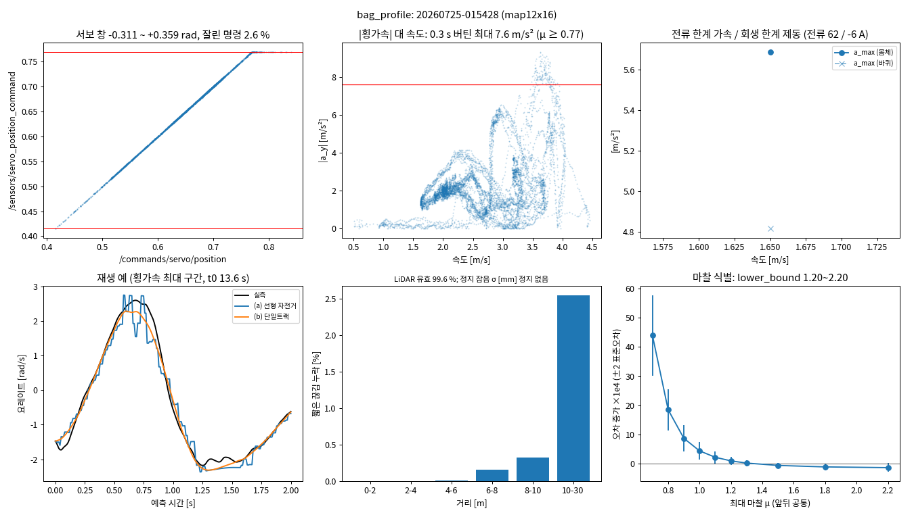

# bag_profile 요약: 20260725-015428

- bag: `real_data/02_pre-competition/20260725-015428_map12x16_v4.5_79s_GYRO-BAD_96pct-moving` (79 s, .db3 1개), 장소 코드 **map12x16** (지도 [12.25, 16.4], md5 85f382d643)
- 재생 구간 263개 (충돌로 뺀 구간 0개), 처리 78 s
- **구간 나누기: 자동 인식 (표시 토픽 없음)**

## 계산에 쓴 구간

| 값 | 구간을 찾은 방식 |
|---|---|
| 서보 창 양 끝 | 자동 인식 (bag 전체에서 규칙으로 찾음) |
| 가속·제동 한계, 전류 한계 | 자동 인식 (bag 전체에서 규칙으로 찾음) |
| 그립 하한, 미끄러진 사건 | 자동 인식 (bag 전체에서 규칙으로 찾음) |
| 저속 정상 선회 | 자동 인식 (bag 전체에서 규칙으로 찾음) |
| 코스트다운 | 자동 인식 (bag 전체에서 규칙으로 찾음) |
| 조향 응답(처프) | 자동 인식 (bag 전체에서 규칙으로 찾음) |
| 지연·트림·재생 맞춤·IMU 바이어스·LiDAR | bag 전체 (구간 표시와 무관) |

## 이 bag에서 못 재서 프로필·기본값으로 대체된 것

- 없음 (서보 변환식, ERPM 환산, 자이로·가속도 단위 모두 이 bag에서 정함)

## setup.yaml

없음: bag 폴더 안이나 옆에 `setup.yaml` 을 두거나 `--setup` 으로 지정하면 설정값 대조와 수동 실측 입력이 된다.

## 차 보정 기록 (car_calibration.yaml)

| 값 | 수치 | 오차/구간 | 단위 | 출처 | 상태 | 방법 |
|---|---|---|---|---|---|---|
| car.servo_map_gain | -0.530 | — | servo/rad | 실측 | 측정됨 | fit: /ackermann_cmd vs /commands/servo/position |
| car.servo_map_offset | 0.605 | — | servo | 실측 | 측정됨 | fit: /ackermann_cmd vs /commands/servo/position |
| car.steer_window | [-0.311, 0.359] | — | rad (command) | 실측 | 하한만 | range of /sensors/servo_position_command through the servo map; an edge is measured when l |
| car.erpm_gain | 4514.000 | — | ERPM/(m/s) | 실측 | 측정됨 | /commands/motor/speed / Ackermann speed (median) |
| car.gyro_unit | deg/s | — |  | 실측 | 측정됨 | gyro z regressed on the localisation heading rate and on v tan(steer)/L |
| car.accel_unit | g | — |  | 실측 | 측정됨 | |a| at standstill |
| car.imu_axes | corr_ay_vr 0.972, corr_ax_dvdt 0.945, corr_ax_vr 0.039, ax_sign 1.000, ay_sign 1.000 | — |  | 실측 | 측정됨 | sign of a_y against v*r and of a_x against dv/dt |
| car.imu_bias |  | — | rad/s, m/s^2 | 실측 | 식별 안 됨 | median over standstill >= 1 s |
| car.delay_cmd_to_yaw_xcorr | 0.147 | [0.145, 0.150] | s | 실측 | 측정됨 | xcorr of v*tan(steer_applied)/L with gyro z (1 s high-pass), moving stretches >= 3 s |
| car.straight_cmd | 0.025 | [0.022, 0.028] | rad | 실측 | 측정됨 | zero crossing of r/v vs applied steering command, |cmd| < 0.08 rad, v > 1.5 m/s |
| car.current_max | 61.649 | — | A | 실측 | 하한만 | 하한만 (한계에 평평하게 붙은 구간이 확인되지 않음): extreme 61.6 A, but only 0 flat stretch(es) (>= 2 needed):  |
| car.current_min | -5.594 | — | A | 실측 | 하한만 | 하한만 (한계에 평평하게 붙은 구간이 확인되지 않음): extreme -5.6 A, but only 0 flat stretch(es) (>= 2 needed):  |
| car.lin_model | k 0.946, tau 0.160, b -0.011, kus 0.009 | — | k [-], tau [s], b [rad], kus [s^2/m] | 추정 | 측정됨 | (a) r = v tan(k d(t-tau)+b)/(L+K v^2), 1 s yaw-rate fit |
| car.speed_loop | tau_m 0.121, tau_v 0.060, a_a 3.909, a_b 1.514, v_s 10.000 | — | s, m/s^2 | 추정 | 측정됨 | first-order loop on the delayed command, accel clipped [-a_b, a_a] |
| car.coast_c0 | — | — | m/s^2 | 추정 | 식별 안 됨 | 식별 안 됨: 전류 0.5 A 이하로 1.0 s 이상 속도가 줄어든 구간이 없음 (후보 샘플 2.5 s, 구간 합계 필요 3.0 s) |
| car.coast_c2 | — | — | 1/m | 추정 | 식별 안 됨 | 식별 안 됨: 전류 0.5 A 이하로 1.0 s 이상 속도가 줄어든 구간이 없음 (후보 샘플 2.5 s, 구간 합계 필요 3.0 s) |
| car.steer_tau_d | — | — | s | 추정 | 식별 안 됨 | 식별 안 됨: 일관성 0.6 이상인 주파수 점 2개 (필요 6개), 대역 평균 일관성 0.41 |
| car.steer_tau_s | — | — | s | 추정 | 식별 안 됨 | 식별 안 됨: 일관성 0.6 이상인 주파수 점 2개 (필요 6개), 대역 평균 일관성 0.41 |
| car.steer_tau_sum | — | — | s | 추정 | 식별 안 됨 | 식별 안 됨: 일관성 0.6 이상인 주파수 점 2개 (필요 6개), 대역 평균 일관성 0.41 |
| vehicle.a_brake | — | — | m/s^2 | 실측 | 식별 안 됨 | no regen-limited braking in the bag |
| vehicle.c_roll | — | — | m/s^2 | 추정 | 식별 안 됨 | coast_c0 (코스트다운) |
| vehicle.c_drag | — | — | 1/m | 추정 | 식별 안 됨 | coast_c2 (코스트다운) |
| actuator.steer_bias | -0.011 | — | rad | 추정 | 측정됨 | (a) trim; the simulator adds it after its own steer_gain |
| actuator.cmd_delay | 0.071 | — | s | 추정 | 식별 안 됨 | (b) pure delay; pair with servo_tau |
| actuator.servo_tau | 0.047 | — | s | 추정 | 식별 안 됨 | (b) servo first-order lag |
| lidar.mount_x | 0.099 | — | m (ahead of CoG) | 설정값(규격) | 식별 안 됨 | /tf_static base_link->laser x 0.270 minus lr 0.17145 (base_link = rear axle) |
| lidar.mount_z | 0.110 | — | m | 설정값(규격) | 식별 안 됨 | /tf_static z |
| odom.erpm_quantum | 0.000222 | — | m/s | 실측 | 측정됨 | p0.5 of nonzero |dv| on /odom (one ERPM step) |

새 추정기 두 개(코스트다운 `car.coast_*`, 조향 응답 `car.steer_*`)는 **실차 미검증**이다: 합성 신호로 값을 되찾는지만 시험했고 실차 녹화로는 한 번도 돌려 보지 않았다.

- 코스트다운: **not_identified** -- 식별 안 됨: 전류 0.5 A 이하로 1.0 s 이상 속도가 줄어든 구간이 없음 (후보 샘플 2.5 s, 구간 합계 필요 3.0 s)
- 조향 응답: **not_identified** -- 식별 안 됨: 일관성 0.6 이상인 주파수 점 2개 (필요 6개), 대역 평균 일관성 0.41

## 장소 프로필 (place_profile.yaml)

| 값 | 수치 | 오차/구간 | 단위 | 출처 | 상태 | 방법 |
|---|---|---|---|---|---|---|
| place.ay_max_held | 7.592 | — | m/s^2 | 실측 | 하한만 | max over the marked/auto stretches of |a_y| (IMU, 0.1 s mean) held >= 0.3 s with body-slip |
| place.mu_lower_from_ay | 0.774 | — |  | 실측 | 하한만 | ay_max_held / g (no load transfer, no aero) |
| place.slides_seen | [] | — | s | 실측 | 측정됨 | body-slip change > 30 deg within 1 s at v > 2 m/s (from a_y / v - r) |
| place.mu_tyre_fit | 1.200 | [1.200, 2.200] |  | 추정 | 하한만 | profile of the shared peak friction of the (b) single-track model, block-paired test |
| place.stiffness_sf | 1.544 | [1.500, 1.500] | 1/rad per unit load | 추정 | 식별 안 됨 | (b) per-axle slope of F/Fz, profile with block-paired test |
| place.stiffness_sr | 2.028 | [2.028, 2.028] | 1/rad per unit load | 추정 | 측정됨 | (b) per-axle slope of F/Fz, profile with block-paired test |
| place.lidar_dropout_by_range | [r [0, 2], miss_frac 0.000, n 1122077, r [2, 4], miss_frac 0.000, n 456804, r [4, 6], miss_frac 6.23e-05, n 80280, r [6, 8], miss_frac 0.002, n 27374, r [8, 10], miss_frac 0.003, n 5663, r [10, 30], miss_frac 0.025, n 236] | — |  | 실측 | 측정됨 | short gaps (<= 5 beams) between agreeing returns, binned by their range |
| place.lidar_valid_frac | 0.996 | — |  | 실측 | 측정됨 | all beams, all scans read |
| place.map | /home/shchon11/F1tenth_E2E/docs/pm/sysid-2026-11-28/examples/20260725-015428/map/20260725-015428.yaml | — |  | 실측 | 측정됨 | bag_map source=map |

## 재생 오차 (이 bag, 중앙값)

| 모델 | 요레이트 0.5/1/2 s | 위치 2 s |
|---|---|---|
| (a) | 0.117 / 0.115 / 0.117 | 0.31 |
| (b) | 0.094 / 0.099 / 0.100 | 0.36 |

(a), (b)는 이 bag으로 맞춘 값(표본 안 오차). car_profile은 --car 프로필 값 그대로(표본 밖).

## 이 bag으로 못 잰 것 (a): 이런 녹화로 잴 수 있었는데 조건이 모자란 것 -- 다시 찍으면 됨

| 값 | 무엇이 얼마나 모자랐나 | 시험 | 시험이 정하는 것 |
|---|---|---|---|
| IMU 바이어스 | 정지 구간 0.0 s (연속 1.0 s 이상 필요) | 정지 10 s (bag 앞뒤) | IMU 바이어스, 자이로 단위 확인, LiDAR 정지 잡음 |
| LiDAR 정지 잡음 | 거의 정지한 스캔 0.0 s (바퀴 속도 < 0.01 m/s, 자이로 < 0.03 rad/s 로 1.0 s 블록이 필요) | 정지 10 s (bag 앞뒤) | IMU 바이어스, 자이로 단위 확인, LiDAR 정지 잡음 |
| 최대 마찰 (상한) | 미끄러진 사건 0회 (1 s 안 차체 미끄럼 변화 > 30°, v > 2.0 m/s 가 필요): 하한 7.6 m/s² 만 있음 | 일정 반경 속도 램프, 미끄러질 때까지 (좌우) | 최대 마찰(상한), 한계에서 앞/뒤 어느 쪽이 먼저 빠지는지 |
| 조향 이득 k 와 언더스티어 K 의 분리 | 저속 정상 선회 1.9 s (10 s 필요) | 저속(1~1.5 m/s) 정상 원선회, 조향 3~4단계, 좌우 | 조향 이득과 언더스티어를 떼어 냄 (k·K 맞바뀜 해소) |
| 서보 창 양 끝 | 낮은 쪽 끝 밖 명령 0개 (끝마다 3개 필요) | 정지 상태 좌우 최대 조향 명령 + 바퀴 각 측정 | 서보 창 양 끝, 명령->바퀴 각 이득 |
| 구동 한계 a_max(v) | 한계 전류 구간 0.5 s, 속도 구간 1칸 (3칸 필요, 칸마다 10샘플) | 직선 전개 가속 -> 최대 제동 x3~4 | a_max(v), v_switch, a_brake, 회생 전류 한계 |
| 제동 한계 a_brake | 회생 한계 전류 구간 0 s (0.2 s 이상 필요) | 직선 전개 가속 -> 최대 제동 x3~4 | a_max(v), v_switch, a_brake, 회생 전류 한계 |
| 구동 전류 한계 | 한계에 평평하게 붙은 구간 0개 (2개 필요): bag 안 극값 61.6 A 는 하한만 | 직선 전개 가속 -> 최대 제동 x3~4 | a_max(v), v_switch, a_brake, 회생 전류 한계 |
| 회생 전류 한계 | 한계에 평평하게 붙은 구간 0개 (2개 필요): bag 안 극값 -5.6 A 는 하한만 | 직선 전개 가속 -> 최대 제동 x3~4 | a_max(v), v_switch, a_brake, 회생 전류 한계 |
| 구름·공기 저항 | 전류 0.5 A 이하로 1.0 s 이상 속도가 줄어든 구간이 없음 (후보 샘플 2.5 s, 구간 합계 필요 3.0 s) | 코스트다운 6 m/s -> 정지 x2 | 구름·공기 저항 (c_roll, c_drag) |
| 조향 응답 (지연·서보 지연) | 식별 안 됨: 일관성 0.6 이상인 주파수 점 2개 (필요 6개), 대역 평균 일관성 0.41 | 조향 스텝·처프 (2~3개 속도, 0.5~4 Hz) | 순수 지연과 서보 지연을 따로, 요 동특성 |

## 주행 녹화로는 원래 안 나오는 것 (b): 손으로 재서 setup.yaml 의 `hand_measured:` 에 적을 것

| 값 | 왜 안 나오나 | 넣는 방법 |
|---|---|---|
| 명령 조향각 -> 실제 바퀴 각 | bag 에 바퀴 각 측정이 없음 (k 는 타이어 강성과 맞바뀜) | 정지 상태에서 좌우 풀락과 중간 단계의 바퀴 각을 각도기·사진으로 재서 setup.yaml `hand_measured.wheel_angle_table` 에 적음 |
| 질량 | bag 으로 식별 불가 (힘이 질량당으로만 보임) | 저울로 재서 setup.yaml `hand_measured.mass_kg` |
| 무게중심 앞뒤 위치 | bag 으로 식별 불가 | 바퀴별 저울 값으로 계산해 `hand_measured.cg_from_rear_axle_m` (뒤차축에서 무게중심까지) |
| 요 관성 | bag 으로 식별 불가 | 이중 줄 매달기·진자로 재서 `hand_measured.yaw_inertia_kgm2` |
| LiDAR 장착 위치 (실측) | /tf_static 은 설정값이지 잰 값이 아님 | 줄자로 base_link(뒤차축) 기준 x, y, z 를 재서 `hand_measured.lidar_mount_m: [x, y, z]` |
| 한계에서 앞이 먼저 빠지는가 뒤인가 | 주행 신호만으로는 안 갈림 | 그립 램프(T6)를 영상으로 찍어 사람이 판정 (도구에 입력 경로 없음) |

## 이 실행에 쓴 문턱값 (f1sim/bag_profile/thresholds.py)

| 이름 | 값 | 단위 | 뜻 |
|---|---|---|---|
| SEGMENT_DEDUP_S | 2.0 | s | 같은 구간 표시가 이 시간 안에 되풀이되면 한 번으로 셈 (ros2 topic pub 을 3번 내는 관례) |
| SERVO_PAIR_TOL_S | 0.01 | s | Ackermann 명령과 서보 명령을 한 쌍으로 보는 시간차 |
| SERVO_FIT_MIN_PAIRS | 20 | 쌍 | 서보 변환식을 맞추는 데 필요한 최소 쌍 수 |
| SERVO_FIT_MIN_STEER_STD | 0.02 | rad | 서보 변환식을 맞추는 데 필요한 조향 표준편차 |
| SERVO_FIT_INLIER_TOL | 0.01 | 서보 값 | 변환식에서 이만큼 안이면 정상값으로 셈 |
| CLAMP_PAIR_TOL_S | 0.02 | s | 서보 명령과 적용 위치를 짝짓는 시간차 |
| CLAMP_EDGE_MIN_CMDS | 3 | 개 | 창 끝이 '관측됨'이려면 그 밖으로 나간 명령 수 |
| CLAMP_EDGE_MARGIN | 0.001 | 서보 값 | 창 밖으로 치는 최소 거리 |
| ERPM_MIN_SPEED_CMD | 0.5 | m/s | ERPM 환산에 쓰는 속도 지령 하한 |
| ERPM_MIN_PAIRS | 10 | 쌍 | ERPM 환산에 필요한 지령-회전수 쌍 수 |
| ERPM_ODOM_MIN_V | 1.0 | m/s | /odom 으로 환산을 대조할 때의 속도 하한 |
| ERPM_ODOM_MIN_SAMPLES | 50 | 개 | /odom 대조에 필요한 샘플 수 |
| STILL_V | 0.02 | m/s | 정지로 보는 바퀴 속도 상한 |
| STILL_SECONDS | 1.0 | s | 정지 구간의 최소 길이 (바이어스, 가속도 단위) |
| UNIT_MIN_V | 1.0 | m/s | 자이로 단위·축 부호 판정에 쓰는 속도 하한 |
| UNIT_MIN_SAMPLES | 200 | 개 | 자이로 단위 판정에 필요한 샘플 수 (2 s) |
| GYRO_DEG_P99 | 15.0 | raw | 기준이 없을 때 |gz| p99 가 이보다 크면 deg/s 로 추정 |
| DELAY_MIN_V | 1.5 | m/s | 겉보기 지연에 쓰는 속도 하한 |
| DELAY_MIN_SEG_S | 3.0 | s | 겉보기 지연에 쓰는 움직임 구간의 최소 길이 |
| DELAY_MAX_LAG_S | 0.4 | s | 겉보기 지연 교차상관 탐색 한계 |
| TRIM_MAX_STEER | 0.08 | rad | 트림 판정에 쓰는 '거의 직진' 조향 한계 |
| TRIM_MIN_V | 1.5 | m/s | 트림 판정 속도 하한 |
| TRIM_MAX_DR | 1.0 | rad/s^2 | 트림 판정에서 요레이트 변화율 상한 |
| TRIM_MIN_SAMPLES | 200 | 개 | 트림에 필요한 샘플 수 (2 s) |
| CUR_LIMIT_FRAC | 0.9 | 비율 | 전류가 한계의 이 비율 이상(회생은 이하)이면 한계 구간으로 셈 |
| ACCEL_MIN_RUN_S | 0.2 | s | 한계 전류 구간의 최소 길이 |
| ACCEL_TRIM_S | 0.05 | s | 한계 구간 양 끝에서 버리는 길이 (필터 영향) |
| ACCEL_BIN_MIN_SAMPLES | 10 | 개 | 속도 구간 한 칸이 표에 들어가는 최소 샘플 수 |
| ACCEL_MIN_BINS | 3 | 칸 | a_max 가 '측정됨'이려면 필요한 속도 구간 수 (0.3~3, 3~5, 5~7, 7~9, 9~20 m/s 중) |
| CUR_PLATEAU_BAND | 0.02 | 비율 | 전류 평탄 구간: 극값의 이 비율 안 |
| CUR_PLATEAU_MIN_S | 0.2 | s | 전류 평탄 구간의 최소 연속 길이 |
| CUR_PLATEAU_MIN_RUNS | 2 | 개 | 전류 한계가 '측정됨'이려면 필요한 서로 다른 평탄 구간 수 |
| CUR_PLATEAU_SEP_S | 0.5 | s | 서로 다른 평탄 구간으로 세려면 떨어져 있어야 하는 시간 |
| LAT_HOLD_S | 0.3 | s | 그립 하한: 이만큼 유지된 횡가속만 셈 |
| LAT_NOSLIP_DEG | 5.0 | deg | 그립 하한: 유지 구간 안 차체 미끄럼 변화 상한 |
| SLIDE_DEG | 30.0 | deg | 미끄러진 사건: 1 s 안 차체 미끄럼 변화 |
| SLIDE_WINDOW_S | 1.0 | s | 미끄러진 사건을 보는 창 |
| SLIDE_MIN_V | 2.0 | m/s | 미끄러진 사건의 속도 하한 |
| IMPACT_ACC | 15.0 | m/s^2 | 0.05 s 평균 |a| 가 이보다 크면 충격 (재생 구간과 미끄럼 사건에서 뺌) |
| T2_V_MIN | 0.7 | m/s | 저속 정상 선회 속도 하한 |
| T2_V_MAX | 1.8 | m/s | 저속 정상 선회 속도 상한 |
| T2_MIN_STEER | 0.08 | rad | 저속 정상 선회 최소 조향 |
| T2_MAX_DR | 0.5 | rad/s^2 | 저속 정상 선회 요레이트 변화율 상한 |
| T2_MIN_SECONDS | 10.0 | s | 저속 정상 선회 샘플 합계 최소 (연속일 필요 없음) |
| LIDAR_STILL_V | 0.01 | m/s | LiDAR 정지 잡음: 바퀴 속도 상한 |
| LIDAR_STILL_GYRO | 0.03 | rad/s | LiDAR 정지 잡음: 자이로 크기 상한 |
| LIDAR_STILL_BLOCK_S | 1.0 | s | LiDAR 정지 잡음 블록 길이 |
| LIDAR_GAP_BEAMS | 5 | 빔 | 누락으로 보는 끊김의 최대 빔 수 |
| WIN_STRIDE_S | 0.25 | s | 재생 구간 시작 간격 |
| WIN_MIN_V_START | 1.0 | m/s | 재생 구간 시작 속도 하한 |
| WIN_MIN_V_ALL | 0.3 | m/s | 재생 구간 내내 속도 하한 |
| WIN_MAX_CMD_GAP_S | 0.1 | s | 재생 구간 안 명령 끊김 상한 |
| REPLAY_MIN_WINDOWS | 30 | 개 | 응답·타이어 맞춤에 필요한 재생 구간 수 |
| COAST_MAX_CURRENT | 0.5 | A | 코스트다운: |모터 전류|가 이 이하면 '전류 0' |
| COAST_MIN_V | 0.5 | m/s | 코스트다운에 쓰는 속도 하한 |
| COAST_MIN_RUN_S | 1.0 | s | 코스트다운 한 구간의 최소 길이 |
| COAST_MIN_TOTAL_S | 3.0 | s | 코스트다운 구간 합계 최소 |
| COAST_MIN_SEGMENTS | 2 | 개 | 코스트다운 구간 최소 개수 (오차 추정) |
| COAST_MIN_V_SPAN | 2.0 | m/s | 코스트다운 자료의 속도 폭 최소 (c_roll 과 c_drag 를 가르려면) |
| CHIRP_MIN_V | 1.5 | m/s | 처프 분석 속도 하한 |
| CHIRP_WIN_S | 5.0 | s | 처프 구간을 찾는 창 길이 |
| CHIRP_HP_RMS | 0.02 | rad | 자동 인식: 1 Hz 이상 조향 성분의 rms 하한 |
| CHIRP_MIN_TOTAL_S | 10.0 | s | 처프 분석에 필요한 구간 합계 |
| CHIRP_BAND_LO_HZ | 0.5 | Hz | 주파수 응답 맞춤 대역 하한 |
| CHIRP_BAND_HI_HZ | 4.0 | Hz | 주파수 응답 맞춤 대역 상한 |
| CHIRP_MIN_COHERENCE | 0.6 | - | 대역 안에서 이 일관성 이상인 주파수만 맞춤에 씀 |
| CHIRP_MIN_BINS | 6 | 개 | 맞춤에 쓸 주파수 점의 최소 개수 |
| CHIRP_BW_FRAC | 0.1 | 비율 | 입력 조향 성분의 대역폭: 대역 최대 파워의 이 비율 이상인 가장 높은 주파수 |
| CHIRP_SEP_MAX_CI_S | 0.03 | s | 순수 지연의 90 % 구간 폭이 이보다 좁아야 '분리됨' |
| CHIRP_MIN_BANDWIDTH_HZ | 2.0 | Hz | 입력 조향 성분이 이 주파수까지는 있어야 분리 가능 |
| SETUP_TOL_ERPM | 20.0 | ERPM/(m/s) | setup.yaml 대조: ERPM 환산 허용 차 |
| SETUP_TOL_SERVO_GAIN | 0.02 | 서보/rad | setup.yaml 대조: 서보 이득 허용 차 |
| SETUP_TOL_SERVO_OFFSET | 0.01 | 서보 | setup.yaml 대조: 서보 오프셋 허용 차 |
| SETUP_TOL_SERVO_RANGE | 0.01 | 서보 | setup.yaml 대조: 서보 창 끝 허용 차 |
| SETUP_TOL_CURRENT_A | 3.0 | A | setup.yaml 대조: 전류 한계 허용 차 |
| SETUP_TOL_TF_M | 0.01 | m | setup.yaml 대조: LiDAR tf 허용 차 |
| FP_TOL_REGEN_A | 8.0 | A | --car 대조: 회생 전류 허용 차 |
| FP_TOL_DELAY_S | 0.03 | s | --car 대조: 겉보기 지연 허용 차 |
