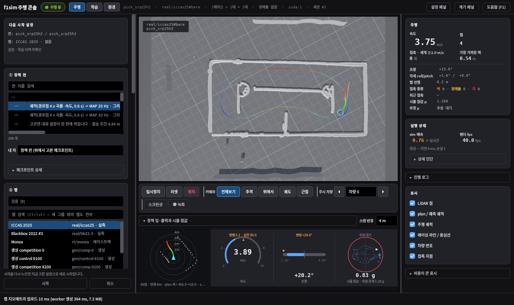
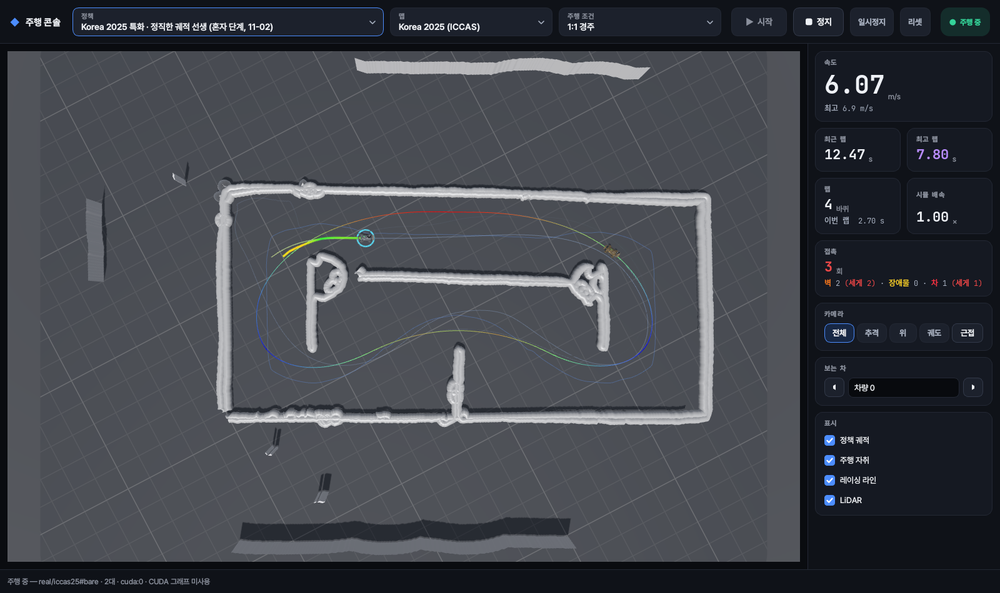

# 콘솔 개편 (2026-11-02)

사용자 요청: "정책 선택하는 칸 너무 불편해 ... 정책 선택 박스 칸 누르면은 쪼르르르 그냥 떠서 거기서 고를 수 있게끔 해줘", "정책 말고 안 쓰는 기능들은 싹 다 지워줘 제발. 너무 난잡해", "UI 너무 쓰레기야 ... 레퍼런스 좀 많이 좀 찾아봐봐. 좀 그냥 쌈뽕하게 직관적으로". 그리고 "나는 콘솔을 통해서만 직접 확인한단 말이야" — 그래서 모든 확인은 실제 콘솔(창 + SessionController + 워커 프로세스)을 화면 밖에서 띄워 찍었습니다(`console_shot.py`).

## 전과 후

| 전 | 후 |
|---|---|
|  |  |
| 정책 목록: 340 px 왼쪽 패널 안, 이름은 "…", 설명은 중간에 끊김, 가로 스크롤, 298개가 한 목록 (`before_policy_list.png`) | 위 막대의 정책 상자를 누르면 넓은 목록이 펼쳐짐: 굵은 이름 + 회색 설명, 오른쪽에 맵 이름표, "추천 정책" 먼저, 검색 (`after_policy_popup.png`) |

## 무엇을 바꿨나

- **위 막대 하나.** [정책 ▾] [맵 ▾] [주행 조건 ▾] [▶ 시작] [■ 정지] [일시정지] [리셋] [상태].
  - 정책·맵 상자: `console/modern.py`의 `RichPicker` / `RichPopup`. 두 줄 항목, 묶음 제목, 띄어쓴 낱말이 모두 들어간 항목만 남기는 검색, 화살표·Enter·Esc. 지금 고른 항목에 파란 막대.
  - 주행 조건: 혼자 달리기 / 학습 장애물 / 1:1 경주(ForzaETH 0.7~1.0배) / 1:1 경주 + 장애물. 추천 정책을 고르면 그 정책의 설정대로 바뀝니다.
- **3D 화면을 크게.** 왼쪽 위 기술용 이름표(시나리오 id)는 뺐습니다. 바닥은 어두운 슬레이트(감마 후 #757575였던 회색이 장면을 뿌옇게 만들었음), 격자선은 은은하게.
- **오른쪽 계기 하나.** 속도(최고 속도), 최근 랩 / 최고 랩(보라), 랩 수 + 이번 랩 경과, 시뮬 배속, 접촉(벽·장애물·차, 장면과 같은 색), 카메라, 보는 차(경주일 때만), 표시 4개(정책 궤적, 주행 자취, 레이싱 라인, LiDAR).
  - 랩 시간은 워커가 프레임마다 보내는 "이번 랩 경과"(환경의 lap_start_step)로 통과 시각을 잡아 스텝 단위까지 정확합니다. 프레임 간격만으로 재면 그리기가 느릴 때 6.50 s가 6.30 s로 보였습니다.
- **치운 것.** 왼쪽 설정 패널 전체, 학습 화면, 환경 편집기(별도 3D 뷰까지 만들지 않음), 정책 입·출력 게이지, 진단·로그, 녹화·스크린샷(S/R 단축키), 노면 마찰·그립 다이얼, 장치·ROS 같은 고급 설정.
  - 내부 논리는 그대로입니다: 예전 위젯은 숨긴 보관함에서 만들어지고, 세션 설정·컨트롤러·저장된 설정이 그대로 읽습니다.
  - 숨긴 설정이 결과를 몰래 바꾸지 않게, 저장된 장치·설명용 오버레이·노면 마찰은 시작할 때 기본값으로 돌립니다. 저장돼 있던 "마찰 고정 1.2" 때문에 콘솔 랩이 보고한 숫자보다 3 % 빨랐습니다(6.32 s 대 6.50 s).
- **GPU.** 콘솔은 세션을 올릴 여유가 있는 카드 가운데 가장 큰 카드(4070)를 씁니다(`sim_worker.auto_device`). 4070 학습은 `gpu_guard3.sh`가 콘솔이 쓰는 동안 멈춥니다. 전에는 빈 메모리 비율로 5060을 골라 학습과 겹쳐 0.76배속이었습니다.
- **디자인.** 참고: Linear, Raycast 목록, VS Code Quick Pick, Cloudscape Select, Fluent 2 토큰, F1 타이밍 색, RaceLab, rerun·Foxglove 배치.
  - 푸른 기의 검정 4단 바탕, 가는 테두리, 파란 강조 하나. 시작은 파란 채움, 정지는 무채색(빨강은 차 접촉 색).
  - 상태는 그 색을 옅게 깐 알약. 최고 랩은 F1 보라.
  - 글꼴: Pretendard(한글 UI)와 JetBrains Mono(바뀌는 숫자, 폭 고정), 둘 다 SIL OFL로 `f1sim/assets/fonts`에 넣어 `app.register_fonts`로 등록.

## 테스트

- 콘솔·워커 테스트: 통과. 일부러 뺀 기능을 확인하던 4개(정책 입·출력 패널 크기 2, 창 안 편집기 모드, S 단축키)는 이유를 적어 건너뜀. 저장된 마찰을 되살리던 기대는 기본값으로 돌아가는 것으로 바꿈.
- 원래부터 실패하던 것(HEAD 사본에서도 같음): `test_console_gl_lifecycle` 1개, `test_sim_worker_console_integration` 프로세스 비정상 종료.
